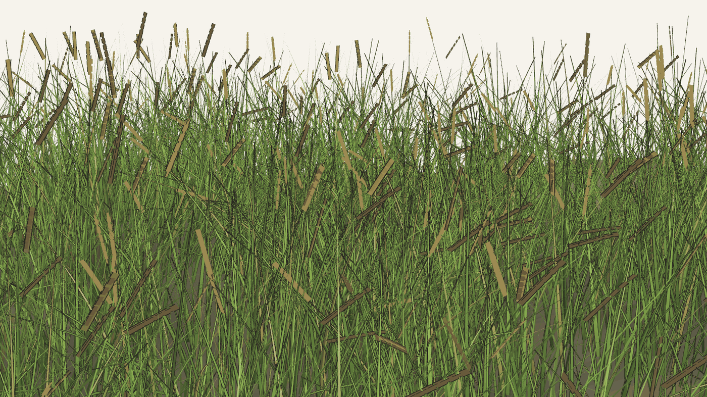
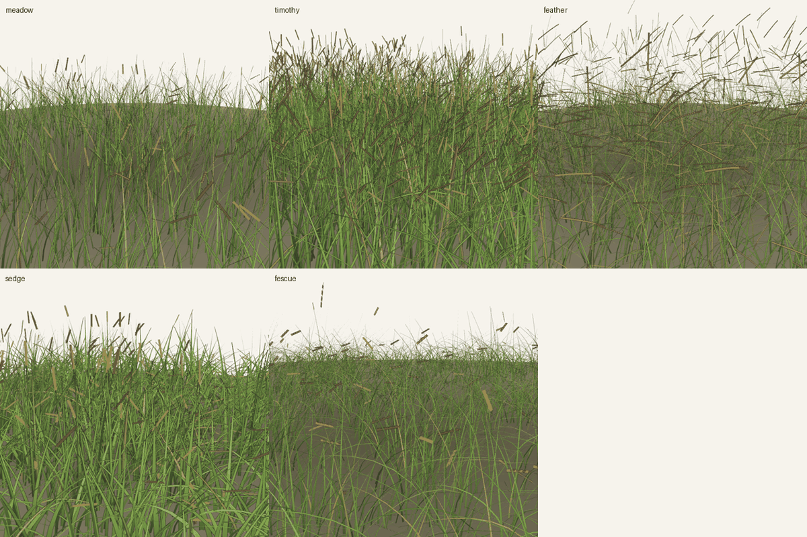
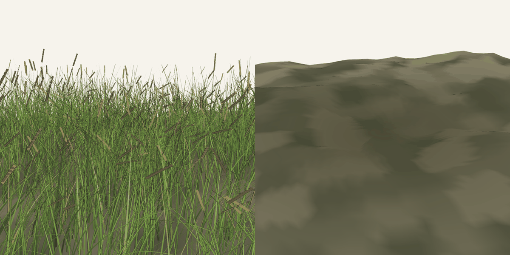
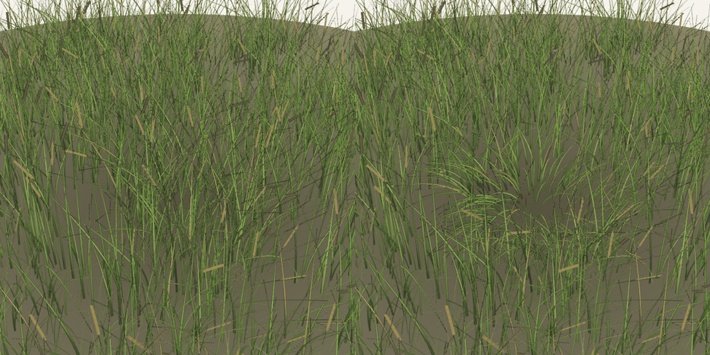

# grass-gen

Procedural grass in Unity. No models, no textures, no simulation. Every blade is a mesh built in C# from a handful of numbers, and the wind bending it comes out of a closed form, so any frame can be drawn on its own without the frame before it.



## The wind

A blade of grass is a cantilever beam. Push it and it answers like a driven damped oscillator: it lags behind the push, and it answers loudest when the push lands near its own natural frequency. Both fall out of two lines.

```
gain = 1 / sqrt((1 - r^2)^2 + (2*zeta*r)^2)
lag  = atan2(2*zeta*r, 1 - r^2)
```

`r` is the drive frequency over the blade's own, and the blade's own comes from beam theory. That is where the look comes from: natural frequency falls with the square of length, compliance grows with its cube. Short stiff blades twitch, tall soft ones roll. Nobody tunes that by hand.

Wind is a few gusts summed, each with its own frequency, strength and wavelength, each travelling across the field. Every blade answers each gust through its own gain and lag.

Nothing is remembered anywhere. Give it a seed, a place and a moment, and the same field comes back every time, which means frame 400 renders without rendering frames 1 to 399.

## Species

Five presets.

```
meadow     fine and soft, the default
timothy    tall and stiff, a slim dense spike
feather    long, drooping, plumed awns
sedge      wide stiff blades, deep fold
fescue     very fine, short, heavily tufted
```



A plumed awn is not a spike with smaller grains. Hairs run radially around it, four per node, the ring rolled 47 degrees each step. Two hairs lying in one plane read as a comb from every angle, and you get a fern instead of feather grass.

Outline weight follows blade width. A fixed line looks right on a wide sedge blade and swallows a fescue one whole.

## Ground

The ground is a height field, four octaves of lattice noise off the same hash that sows the blades. Blades seat on it and lean with the slope. Shading reads the sowing density itself: thick clumps darken the soil under them, bare patches stay light, a trampled spot goes darker still. Shadow follows the grass for free, since both read one function.



## Trampling

Put something on the field and the blades around it splay outward and squat. Distance from root to centre, falloff to a power, and out of that come both the turn and the crouch. Nothing is stored, so a walking character is just a function of where it stands.



## Running it

Unity 6000.3.5f2 with URP 17.3. Open `Assets/Scenes/Grass.unity` and press Play. The builder runs in edit mode too, so inspector tweaks rebuild right away.

## Layout

```
GrassWind       driven damped oscillator, gain and lag per blade
GrassTerrain    height field and slope
GrassField      sowing, clumps, bare patches, the gust series
GrassBlade      spine and folded V section of one blade
GrassPlume      feathery awn
GrassSeedHead   spikes and grains
GrassTrample    splay and crouch around a pressed spot
GrassGround     ground mesh and its shading
GrassSpecies    the five presets
GrassFlat       the shader, two-tone light plus an ink pass
```

## License

MIT
